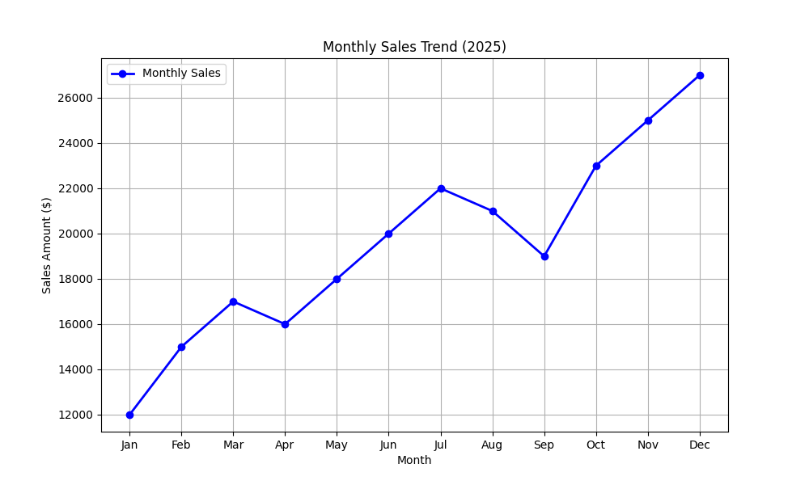
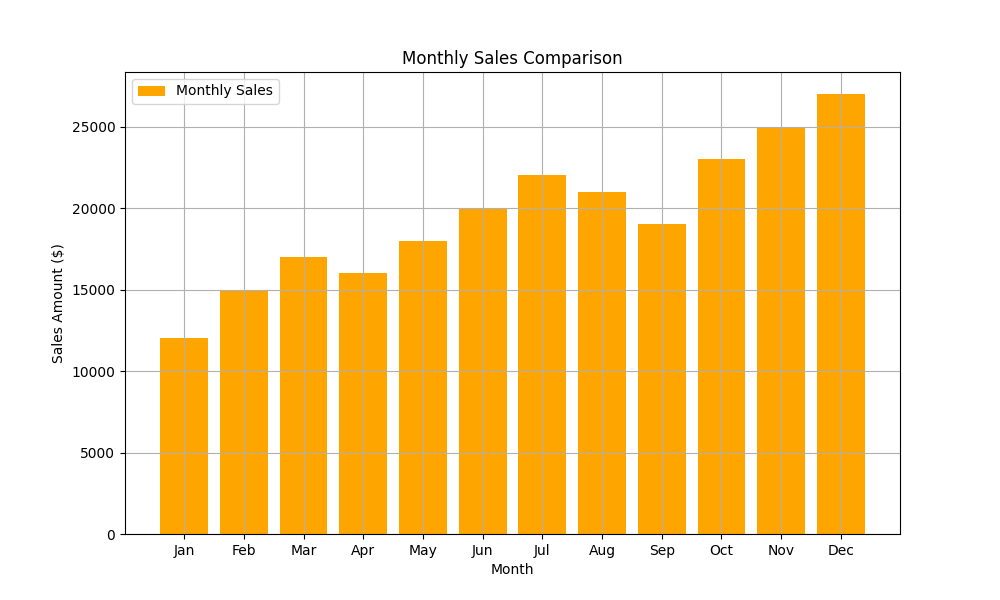

# Monthly Sales Visualization Project

## Problem Overview
Build a data visualization script using **Matplotlib** to analyze monthly sales performance through both trend-based line charts and categorical bar charts.

## Dataset
Two parallel Python lists representing 12 months of sales performance:
* `months`: `['Jan', 'Feb', 'Mar', 'Apr', 'May', 'Jun', 'Jul', 'Aug', 'Sep', 'Oct', 'Nov', 'Dec']`
* `sales`: `[12000, 15000, 17000, 16000, 18000, 20000, 22000, 21000, 19000, 23000, 25000, 27000]`

## Objectives
1. **Load Data:** Create matching Python lists for months and monthly sales amounts.
2. **Plot Line Chart:** Visualize sales trends over time using `plt.plot()` with custom markers, line styling, labels, gridlines, and a legend, saving the output as `sales_trend.png`.
3. **Plot Bar Chart:** Compare monthly sales volumes side-by-side using `plt.bar()` with titles, axis labels, gridlines, and a legend, saving the output as `sales_bar_chart.png`.

## Visualizations

### Monthly Sales Trend (Line Chart)

### Monthly Sales Comparison (Bar Chart)

## Key Learnings & Notes
* **Canvas Initialization (`plt.figure(figsize=(10, 6))`):** Creating a new figure at the start of each plotting function automatically isolates charts onto separate canvases without needing `plt.close()`.
* **Keep Figures Open for Automated Graders:** Avoid calling `plt.close()` inside functions tested by automated suites (like CodeChef), as closing the figure clears it from memory and causes `list index out of range` errors when tests inspect active figures.
* **Legend Labels:** Passing `label="Monthly Sales"` inside `plt.plot()` or `plt.bar()` is required before calling `plt.legend()` so Matplotlib knows what text to display in the legend box.
* **Headless Mode (`matplotlib.use("Agg")`):** Renders and saves charts directly to `.png` image files without needing a graphical display window.
