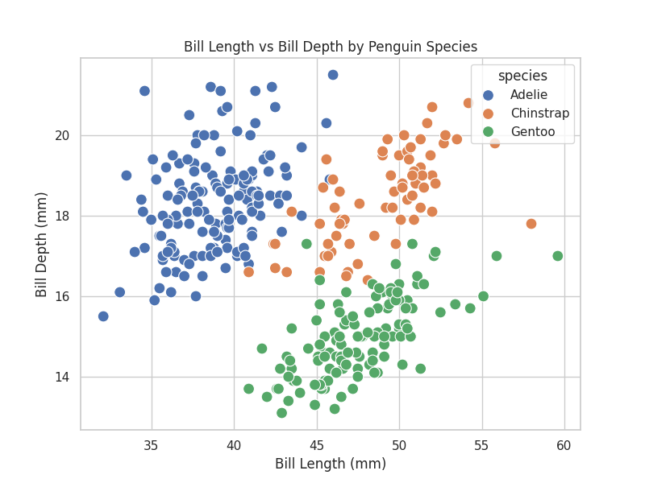
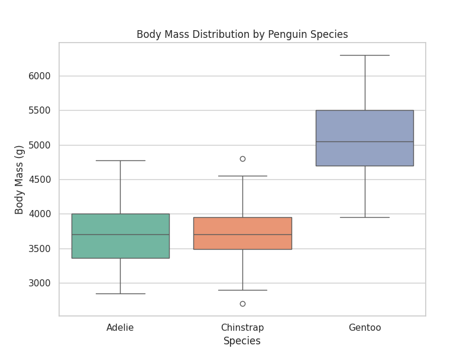

# Penguin Species Explorer Project

## Problem Overview
Build a statistical data visualization script using **Seaborn** and **Matplotlib** to clean and explore morphological measurements across different penguin species.

## Dataset
Seaborn's built-in `penguins` dataset (`sns.load_dataset("penguins")`), cleaned of missing (`NaN`) rows, focusing on four key attributes:
`species`, `bill_length_mm`, `bill_depth_mm`, and `body_mass_g`

## Objectives
1. **Configure Styling:** Apply Seaborn's `"whitegrid"` theme globally using `sns.set_theme(style="whitegrid")`.
2. **Load & Clean Data:** Load the `penguins` dataset, remove rows containing missing values with `df.dropna()`, and preview the first 5 rows of relevant columns.
3. **Compare Bill Dimensions (Scatter Plot):** Visualize `bill_length_mm` vs. `bill_depth_mm` grouped by `species` using `sns.scatterplot()`, saving the output as `bill_comparison.png`.
4. **Analyze Body Mass Distribution (Box Plot):** Compare `body_mass_g` spread and median values across species using `sns.boxplot()`, saving the output as `body_mass_distribution.png`.

## Visualizations

### Bill Length vs Bill Depth by Penguin Species (Scatter Plot)

### Body Mass Distribution by Penguin Species (Box Plot)

## Key Learnings & Notes
* **Built-In Datasets (`sns.load_dataset("penguins")`):** Seaborn loads sample datasets directly as Pandas DataFrames (note the plural `"penguins"`), allowing standard Pandas cleaning methods without explicitly importing `pandas`.
* **Reassigning `.dropna()`:** Calling `df.dropna()` alone returns a cleaned copy without modifying the original DataFrame—always assign it back (`df = df.dropna()`) or use `inplace=True` so `NaN` values are actually removed.
* **Seaborn vs. Matplotlib Roles:** Use `sns` functions (`sns.scatterplot()`, `sns.boxplot()`) for statistical plotting and category grouping (`hue`, `palette`, `s`), while using `plt` functions (`plt.figure()`, `plt.title()`, `plt.xlabel()`, `plt.savefig()`) for canvas sizing, labels, and saving files.
* **Exact Title Matching:** Automated tests check string titles character-by-character, so minor punctuation differences (like `vs.` vs. `vs`) will fail assertion checks.
