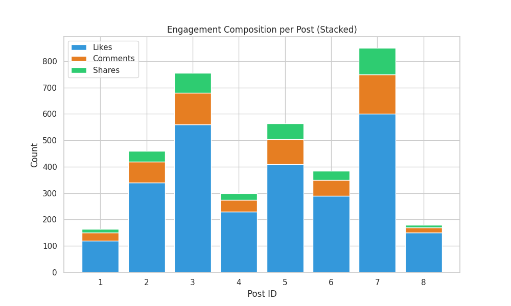
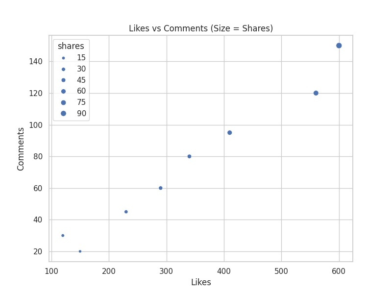
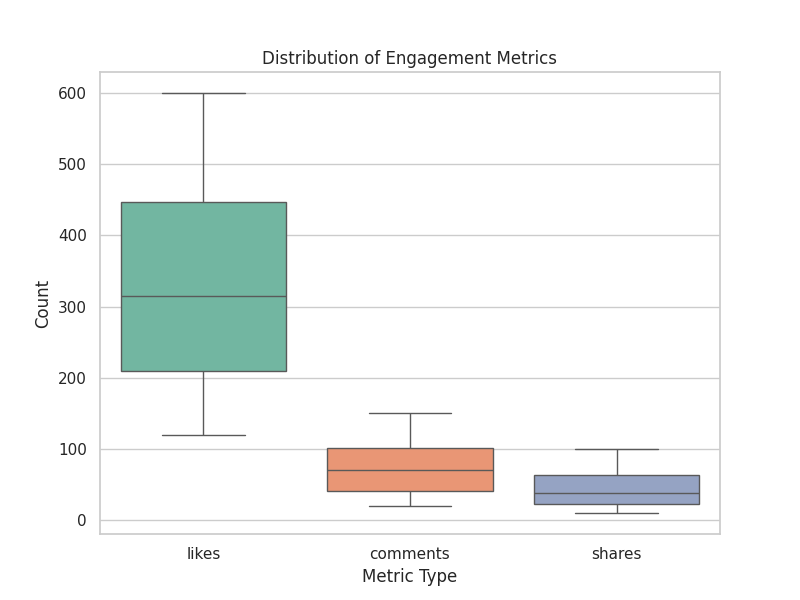

# Social Media Engagement Analyzer Project

## Problem Overview
Build a multi-chart social media analytics pipeline using **Pandas**, **Matplotlib**, and **Seaborn** to compute total post engagement, visualize stacked metric breakdowns, explore metric correlations via bubble charts, and compare distributions using reshaped data.

## Dataset
A Python dictionary converted into a Pandas DataFrame containing engagement metrics across 8 social media posts:
`post_id`, `likes`, `comments`, and `shares`

## Objectives
1. **Configure Styling:** Set Seaborn's global theme to `"whitegrid"` using `sns.set_theme(style="whitegrid")`.
2. **Load & Compute Total Engagement:** Convert the raw dictionary into a DataFrame and create a derived `total_engagement` column (`likes + comments + shares`).
3. **Stacked Bar Chart (`engagement_composition.png`):** Layer `likes`, `comments`, and `shares` per `post_id` using Matplotlib's `bottom` parameter to show exact engagement composition.
4. **Bubble Chart (`metrics_relationship.png`):** Plot `likes` vs. `comments` with bubble sizes mapped to `shares` using `sns.scatterplot()`.
5. **Reshape & Compare Distributions (`engagement_distribution.png`):** Transform the wide dataset into long format with `df.melt()` and visualize metric spreads using `sns.boxplot()`.

## Visualizations

### Engagement Composition per Post (Stacked Bar Chart)

### Likes vs Comments (Bubble Chart)

### Distribution of Engagement Metrics (Box Plot)

## Key Learnings & Notes
* **Building Stacked Bar Charts (`bottom=`):** Matplotlib stacks bars manually across separate `plt.bar()` calls—Layer 1 starts at `0`, Layer 2 uses `bottom=df['likes']`, and Layer 3 uses `bottom=df['likes'] + df['comments']`.
* **Reshaping Wide Tables (`df.melt()`):** Used `df.melt(id_vars="post_id", value_vars=["likes", "comments", "shares"], var_name="metric", value_name="count")` to unpivot separate metric columns into long format so Seaborn can plot them side-by-side.
* **Seaborn Bubble Charts (`sns.scatterplot`):** Passing `data=df` alongside `size="shares"` automatically scales point areas and generates a size legend (note that the function is named `scatterplot`, not `scatter`).
* **Keyword Argument Precision:** Python parameters are strictly case-sensitive (`color=` instead of `Color=`, `plt.legend()` without an `s`), and column lookups inside `df[...]` must match exact lowercase keys (`df['comments']`).
