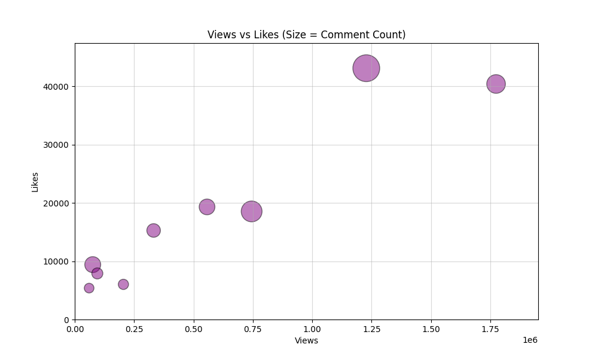
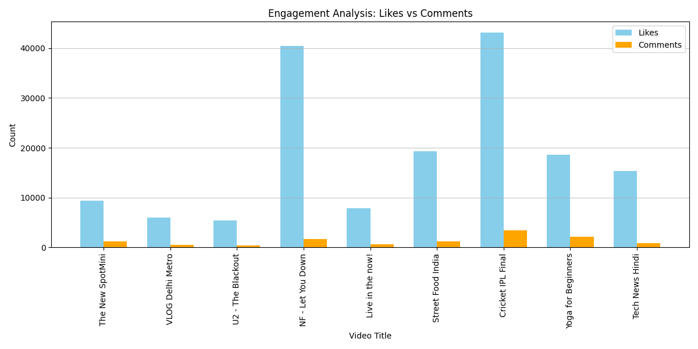

# YouTube Video Engagement Analysis Project

## Problem Overview
Build a multi-chart video analytics script using **Pandas**, **NumPy**, and **Matplotlib** to explore YouTube engagement metrics, compare views against likes using a bubble scatter plot, and contrast likes vs. comments across individual videos using a grouped bar chart.

## Dataset
`youtube.csv` containing engagement statistics across YouTube videos, including:
`title`, `views`, `likes`, and `comment_count`

## Objectives
1. **Load & Preview Data:** Import `youtube.csv` into a Pandas DataFrame and inspect the initial rows.
2. **Bubble Scatter Plot (`Views vs Likes`):** Visualize the relationship between `views` and `likes` with marker sizes scaled proportionally to `comment_count` (`s=0.3 * df['comment_count']`), custom axis padding (`110%` of maximum values), and transparency.
3. **Grouped Bar Chart (`Likes vs Comments`):** Plot side-by-side bars per video using horizontal index offsets (`x - width/2` and `x + width/2`), vertically rotated video title ticks, a legend, and horizontal-only gridlines.

## Visualizations

### Views vs Likes (Bubble Scatter Plot)

### Engagement Analysis: Likes vs Comments (Grouped Bar Chart)

## Key Learnings & Notes
* **Matplotlib Scatter Arguments (`plt.scatter`):** Unlike Seaborn, Matplotlib's `plt.scatter()` takes DataFrame columns directly as positional arguments (`df['views']`, `df['likes']`) rather than a `data=` DataFrame with string names, and uses `s=` for marker area scaling.
* **Preventing Edge Clipping (`plt.xlim` / `plt.ylim`):** Setting upper axis bounds to `1.1 * max()` adds 10% breathing room so large bubbles at the top or right edges are not cut off.
* **Grouped Bar Positioning (`x - width/2` vs. `x + width/2`):** Shifting paired bar series symmetrically around integer NumPy index positions (`np.arange`) places bars cleanly side-by-side without overlapping.
* **Custom Axis Ticks & Directional Grids:** `plt.xticks(x, df['title'], rotation='vertical')` maps long text labels cleanly onto numeric positions, while `plt.grid(axis='y', alpha=0.7)` restricts gridlines strictly to horizontal reference lines.
